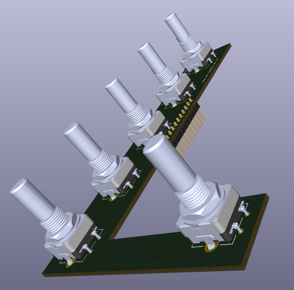

# ARC-164 Rotary Encoder PCB and schematic

**Last updated: October 31, 2026 at 6:19 PM MDT (America/Denver)**

The **ARC-164 encoder PCB v1.1** combines all five frequency encoders and the preset-channel encoder on one board. The layout is routed and includes a front-copper GND pour. **I still need to check mechanical clearances and test-fit the board before ordering PCBs.**

*ARC-164 Encoder PCB — KiCad 3D view. Click to enlarge. Clearance checks and test fitting are still pending.*

## Open the project

Download this folder and keep its contents together. Open [ARC-164 Encoders.kicad_pro](ARC-164%20Encoders.kicad_pro) in KiCad 10, then open the schematic or PCB:

- [Schematic](ARC-164%20Encoders.kicad_sch)
- [PCB layout](ARC-164%20Encoders.kicad_pcb)

The custom symbol library, footprint library, library tables, and PEC11H STEP model are included. The reused library names still begin with ARC210; their paths are relative to this project. KiCad's standard libraries are also needed. I have not included the faceplate drawing, drawing-based pictures, or its reference geometry in these published files.

## Encoders and connections

I placed SW1–SW5 at the five frequency-control positions, left to right, and SW6 at the preset-channel position. The footprint origin is offset from the shaft center; that offset is included in the placement. Frequency centers are 26 mm apart, assuming the supplied drawing is in millimeters. I still need to confirm the drawing scale against the actual faceplate.

All six encoders use Bourns PEC11H-4220F-S0024 footprints. Their C contacts, mounting tabs, and J1 pins 13–14 connect to GND. I corrected the copied schematic's separate common-contact net so the contacts connect to the ground pour. The push-switch contacts remain deliberately unused. ARC-164 Teensy GPIO assignments are not finalized.

| J1 pin | Connection |
| --- | --- |
| 1 | SW1 B |
| 2 | SW1 A |
| 3 | SW2 A |
| 4 | SW2 B |
| 5 | SW3 B |
| 6 | SW3 A |
| 7 | SW4 A |
| 8 | SW4 B |
| 9 | SW5 B |
| 10 | SW5 A |
| 11 | SW6 B |
| 12 | SW6 A |
| 13–14 | GND |

## Validation and remaining checks

Fresh KiCad checks for v1.1 on October 31, 2026 reported **zero ERC violations, zero non-excluded DRC violations, zero unconnected items, and zero schematic/PCB parity issues** under the project's saved settings. The copper zone was refilled before the PCB check. Reports are in [Checks](Checks/). Passing these electrical checks does not establish mechanical fit or a manufacturing-ready design.

I still need to check the actual faceplate dimensions, encoder shaft height and spacers, switch bodies and terminals beside the narrow board section, display hardware, connector and cable access, PCB mounting/support, and 3D model alignment. I will review the layout and run fresh checks again before generating manufacturing files. Gerbers are not included with this version.

[Back to the main README](../../README.md#encoder-pcb-plan)

## Version 1.1 — October 31, 2026

I removed an extra front-copper zone that had no net assigned and was overriding the existing GND pour, causing an isolated-copper violation. I retained and refilled the GND zone, then updated the PCB silkscreen and PCB/schematic revisions to **1.1**. Fresh ERC and DRC checks reported zero violations, zero unconnected items, and zero schematic parity issues under the saved project settings. **Mechanical clearance checks, test fitting, and assembled-board testing remain pending.**
