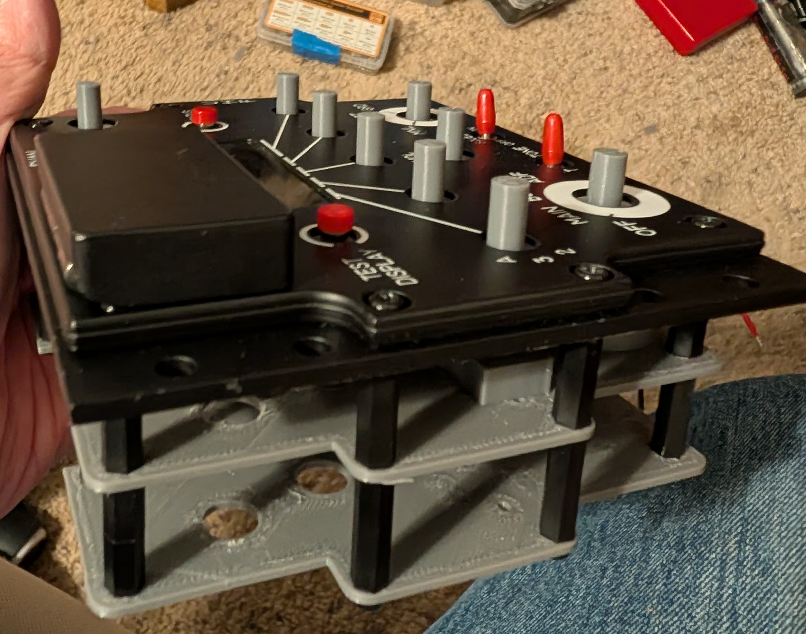
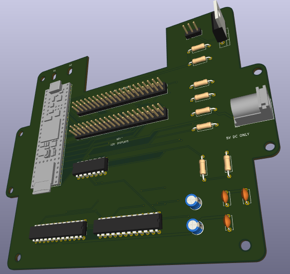
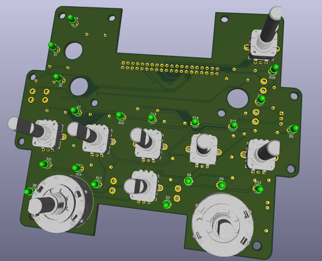
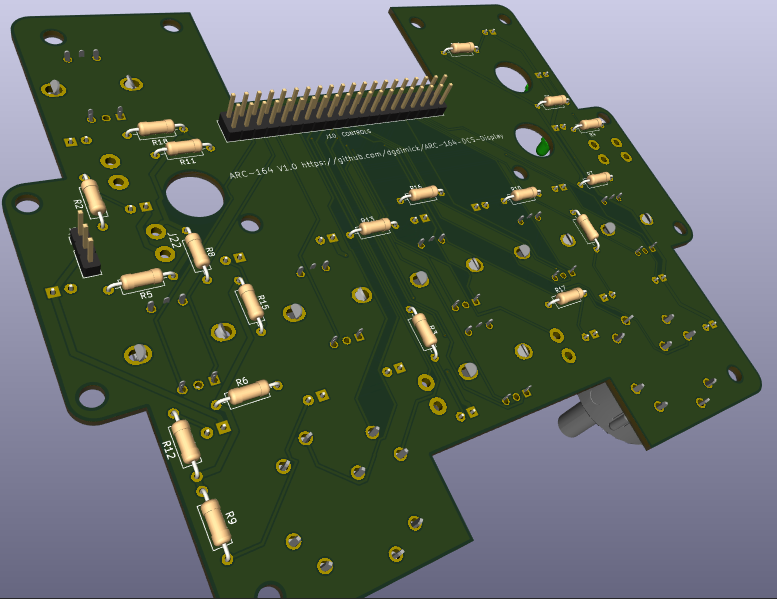
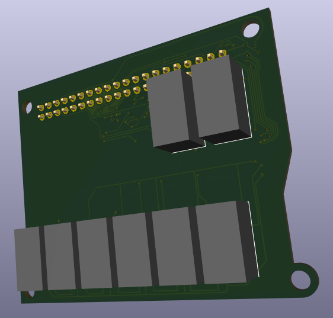
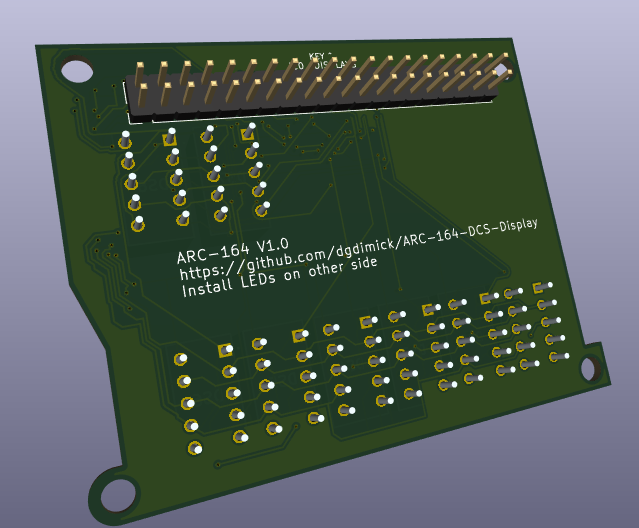

# ARC-164 Radio Panel for DCS

**Last updated: November 8, 2026 at 7:34 AM MST (America/Denver)**
<!-- Refresh this timestamp whenever this README changes; use the actual current America/Denver date and time with the correct MST/MDT abbreviation. -->

  

*Panel reference photo: PC Flights.*

I’m building an ARC-164 radio panel for my SIMPIT and sharing the files and what I learn along the way. I hope you’ll enjoy building one too, and perhaps help me make it better.

## Development update — November 7, 2026

**I’ve published the Version 1.0 PCB prototypes for all three boards: the Main Board, Power Driver Board, and LED Sub-Board.** [Download the complete prototype package](https://github.com/dgdimick/ARC-164-DCS-Display/releases/download/pcb-v1.0-prototype/ARC-164-PCBs-v1.0-Prototype.zip) or see the [PCB download overview](PCBs/README.md) for individual board files and fabrication ZIPs. The package includes editable KiCad projects, libraries and 3D models, schematic PDFs, BOMs, Gerbers, drill files, previews, and [current three-board wiring instructions](PCBs/v1.0-Prototype/Docs/Wiring.md).

I’ve checked the designs in KiCad, and **all three boards pass the design-rule and schematic electrical checks**, with no unconnected items or differences between the schematics and PCBs. The cable pinouts and all 19 backlight LED/resistor connections have been checked too.

**I haven’t assembled and electrically tested these boards yet, so please treat them as prototypes.** I still need to check the complete stack, sockets, cables, and firmware together. I’ll share pictures and what I find as I work through my build. If you give them a try, I’d love to see your build and hear how it goes in [Discussions](https://github.com/dgdimick/ARC-164-DCS-Display/discussions).

I’ve replaced the two-pin power-input header with a **PCB-mounted PJ-102AH barrel power jack at J11 on the Power Driver Board**. The jack sits at the right-hand board edge with its opening facing outward for easy access. It accepts **regulated 5 V DC through a 5.5 × 2.1 mm center-positive plug**.

My recommended supply is the **MEAN WELL GST25A05-P1J (5 V, 4 A)**. You’re welcome to use another supply; just make sure it provides **well-regulated 5 V DC**, enough current, and the correct plug and polarity. See the [power-supply parts-list section](#external-regulated-5-v-power-supply) for the Mouser link, specifications, and mains-cord requirement. The board does not convert a higher input voltage to 5 V.

I’ve also added [recommended IC sockets and Teensy headers](#recommended-ic-sockets-and-teensy-headers) to the parts list, with Mouser links: **two 24-pin sockets for U11/U12, one 14-pin socket for U13, and two pairs of 24-pin male headers and female sockets for the Teensy**. I normally recommend these to reduce the risk of overheating the ICs during soldering and to make replacement easier. Solder the empty IC sockets first, let the board cool, and then install the chips. The Teensy’s male headers still need soldering unless its pins are already fitted.

## Physical mockup — November 6, 2026

Here’s my current ARC-164 mockup, showing the faceplate, control shafts, and display covers together with the 3D-printed board assembly. I’m using this to check the mechanical layout and clearances as I continue building the encoder version. This is a physical mockup, not a completed or electrically tested panel. Click the photo to see it full size.

## Power Board images

### Front of the Power Board

Click the image to view it full size.

## Main Board images

### Front of the Main Board

### Back of the Main Board

Click either image to view it full size.

## PCB Sub-Board images

### Front of the PCB Sub-Board

### Back of the PCB Sub-Board

Click either image to view it full size.

## Development update — November 6, 2026

**PC Flights confirmed they can make the modified ARC-164 panel for US$57 plus a US$20 custom-order fee—US$77 total before any shipping or other charges.** This is their quote for the requested panel changes; I haven’t placed the custom order yet.

I’ve asked whether they would make the modified panel a **stocked option for other builders**, so people following this project could buy it without arranging a special order. I’d be happy to buy one and build with it. **A stocked option has not been confirmed; I’m waiting for their reply.** **While I wait for their reply, I’ll continue building the rotary-encoder version of the ARC-164. I’ll revisit the rotary-switch version later, after completing the ARC-186 and ARC-210 v2.0 projects.**

## Development update — November 4, 2026

I’ve sent **PC Flights a request for a complete new ARC-164 panel** with the five FREQ shaft holes enlarged in **both the front faceplate and clear backing panel**, keeping their centers unchanged. I asked for the holes to match the existing MAIN/PRESET diameter—approximately **10.2 mm in the supplied drawing**—and noted that the Channel control already has a larger hole and that PC Flights uses a similar larger-hole arrangement on its ARC-210 panel.

I also requested **anti-rotation slots in the clear backing panel** and supplied a marked drawing and proposed DXF for review. The slot dimensions, orientation, and any matching relief needed in the front faceplate still need confirmation. I understand this would require purchasing a **complete new panel**.

This would let me revisit frequency rotary switches using the [earlier staggered mounting concept](https://github.com/dgdimick/ARC-164-DCS-Display/blob/394ed3a46d2bc5caa23bab62e20b150761d81306/images/ARC-164_Staggered_PCB_Mount_Concept.png): **two PCBs total for the frequency controls, one carrying the two-switch group and the other carrying the three-switch group**. The picture is historical; its shaft-length labels are not final production dimensions.

**November 6 follow-up:** PC Flights has confirmed they can make the requested changes and supplied the quote above. Stocked availability, final dimensions, and mechanical fit still need confirmation. The current frequency-encoder design remains the working baseline while I investigate this option.

**The rotary-switch alternative is deferred until after the ARC-186 and ARC-210 v2.0 projects. I’ll continue building the frequency-encoder version now, including its LED display.** I’ll revisit the modified panel, switch selection, and parts list when I return to the rotary-switch version.

## Current development order

For these two radio panels, I plan to build and test the **ARC-164**, followed by the **ARC-186**, then investigate additional aircraft support with matching physical radio panels.

**This order may change based on user feedback and interest.** These are plans, not fixed release dates.

### Future versions and upgrades

**Future upgrades:** It may be as long as **two years** before I return to this project with upgrades or a new version. Please treat future-version ideas as long-term plans, with no promised release date.

## Other SIMPIT panels

Once I’ve finished the radio panels, I plan to build other panels for my SIMPIT, including the **SAS and emergency trim panels**. I’ll share those projects as they develop. These are future plans.

## Through-hole components

While I could use surface-mount (SMD) parts to make the boards smaller, I plan to use through-hole components to make the project easier for everyone to build and solder with basic tools.

I’ve linked the parts I’m designing around so you can find the same sizes and pin spacing without having to hunt through listings. You’re welcome to use other suppliers—I buy some parts from Amazon myself. Just compare the dimensions and pin spacing before ordering a substitute so it will fit the PCB.

## Recorded component costs

These are my recorded purchases so far, in **US dollars**. The total includes rotary switches bought before I returned to frequency encoders; it is not a shopping list for the current design. The **A11015RNCQ switches are 10-position switches** and were the wrong parts for the ARC-164. **DigiKey did not cancel my order, so I’ll keep the A11015RNCQ switches as parts for ARC-210 V2**.

| Item | Quantity | Cost (USD) |
|---|---:|---:|
| QBSLDIW301GR white seven-segment LED digits — earlier purchase; superseded by SC36-11SURKWA in the current build plan | 10 | $17.43 |
| A12515RNCQ rotary switches — earlier long-shaft selection; no longer the current MAIN/PRESET choice | 5 | $55.66 |
| A11015RNCQ rotary switches — 10 positions; DigiKey order not canceled, retained for ARC-210 V2 | 3 | $35.07 |
| Tax and tariffs on the rotary-switch and LED order | — | $27.13 |
| Toggle-switch purchase | — | $13.51 |
| Toggle-switch purchase | — | $10.76 |
| Faceplate | 1 | $57.00 |
| Faceplate shipping | — | $13.59 |
| Pushbutton switches | — | $7.99 |
| Teensy 4.1 | 1 | $29.60 |
| Teensy shipping | — | $8.35 |
| **Running total** | | **$276.09** |

My Teensy 4.1 cost **$37.95 including shipping**, and my faceplate cost **$70.59 including shipping**. The rotary switches and LEDs came to **$108.16**, or **$135.29 including tax and tariffs**. Those charges are already included in the running total. I bought two spare LED digits and one spare A12515RNCQ switch because the quantity price breaks saved me money compared with buying only the quantities I originally planned to use. I still need to verify the selected toggle switches’ fit and operation.

I’m keeping the extra displays I bought as spares, since returning them would only get me **US$2.77** back.

**The VOL encoder isn’t included in the total yet.** My current selection for VOL, FREQ, and channel is **PEC11R-4230F-S0024 with a 30 mm shaft**, sourced from Mouser. I’ll add actual encoder costs to this purchase history once the order is confirmed.

**This total is before PCBs, display drivers, resistors, connectors, and the other remaining parts. It is not the complete build cost.** I’ll update the total as I buy the remaining parts. Additional shipping or fees not listed above are also excluded.

## Order sheet — rotary controls and LED digits

**Current build: rotary encoders.** I’ll continue building the encoder version while waiting for PC Flights’ reply about a stocked modified panel. The rotary-switch alternative is deferred until after the ARC-186 and ARC-210 v2.0 projects. The order sheet below is for the encoder version; quantities and fit still need final checks before purchasing.

This is my order sheet for **one ARC-164 panel**, updated **November 4, 2026**. I’ll buy the **30 mm encoders and SC36-11SURKWA LED digits from Mouser**. The MAIN and PRESET switches remain on the DigiKey list. These are full build quantities; I’ll deduct parts I already have before ordering.

| Quantity | Use | Manufacturer part number | Supplier / order number | Estimated unit price (USD) | Estimated total (USD) |
| ---: | --- | --- | --- | ---: | ---: |
| 7 | Five FREQ encoders, channel encoder, and VOL | PEC11R-4230F-S0024 | [Mouser: 652-PEC11R-4230F-S24](https://www.mouser.com/en/ProductDetail/Bourns/PEC11R-4230F-S0024?qs=Zq5ylnUbLm6MC5h%2FLr6Brg%3D%3D) | $2.07 | $14.49 |
| 2 | MAIN and PRESET rotary switches | A12505RNCQ | [DigiKey: CKN10203-ND](https://www.digikey.com/en/products/detail/c-k/A12505RNCQ/2043159) | $13.41 | $26.82 |
| 10 | Red 0.36-inch common-cathode seven-segment LED digits | SC36-11SURKWA | [Mouser: 604-SC36-11SURKWA](https://www.mouser.com/en/ProductDetail/Kingbright/SC36-11SURKWA?qs=FRBiz4Wv1YMkVf5BvlPtDA%3D%3D) | $1.45 | $14.50 |
| | **Estimated subtotal** | | | | **$55.81** |

All seven encoders have **30 mm shafts**. MAIN and PRESET use the **same A12505RNCQ switch**, with the stop ring set to **4 positions for MAIN** and **3 positions for PRESET**; both index at **45° per position**.

This earlier estimate uses the quantity-five encoder tier, quantity-one switch tier, and Mouser’s quantity-ten SC36-11SURKWA LED tier; it has not yet been recalculated for my purchased white displays. The LED price is $1.45 each ($14.50 for ten), checked November 4, 2026. Prices can change; shipping, tax, and tariffs are excluded. This estimate is separate from my recorded purchases.

**This is not the complete build BOM.** TONE, SQL, STATUS, display drivers, other display components, resistors, capacitors, connectors, PCBs, and other remaining parts are excluded.

### Recommended IC sockets and Teensy headers

**I normally recommend using sockets for the DIP ICs and a removable header/socket connection for the Teensy.** This reduces the risk of overheating the ICs when soldering and makes replacement easier. Solder the empty sockets to the PCB first, let the board cool, and then insert the ICs with their pin-1 notches facing the correct way.

| Quantity | Use | Manufacturer part number | Mouser order number / link |
| ---: | --- | --- | --- |
| 2 | 24-pin DIP sockets for the MAX7219 drivers, U11 and U12; 7.62 mm row spacing, 2.54 mm pin pitch | TE Connectivity 1-2199298-8 | [571-1-2199298-8](https://www.mouser.com/ProductDetail/TE-Connectivity/1-2199298-8?qs=fK8dlpkaUMsSY7Gqcrol0Q%3D%3D) |
| 1 | 14-pin DIP socket for the 74AHCT125 buffer, U13; 7.62 mm row spacing, 2.54 mm pin pitch | TE Connectivity 1-2199298-3 | [571-1-2199298-3](https://www.mouser.com/en/ProductDetail/TE-Connectivity/1-2199298-3?qs=fK8dlpkaUMtBOtVI99wRlQ%3D%3D) |
| 2 | Single-row 24-pin male headers for the Teensy 4.1's two outer rows; 2.54 mm pitch | Samtec TSW-124-07-T-S | [200-TSW12407TS](https://www.mouser.com/en/ProductDetail/Samtec/TSW-124-07-T-S?qs=rU5fayqh%252BE26VY6qw728rQ%3D%3D) |
| 2 | Matching single-row 24-pin female sockets on the Power Driver Board; 2.54 mm pitch | Samtec SSW-124-01-T-S | [200-SSW12401TS](https://www.mouser.com/ProductDetail/Samtec/SSW-124-01-T-S?qs=iT52DjcXudvCUishYlzKnw%3D%3D) |

All of these parts are through-hole and can be hand soldered. The Teensy still needs its male headers soldered on unless you buy it with pins already fitted; use a temperature-controlled iron and avoid prolonged heating. The female sockets let you unplug the complete Teensy module from the Power Driver Board. Check the added socket/header height when setting the clearance to the board above it. These items are separate from the rotary-control and LED subtotal; check current supplier pricing.

### External regulated 5 V power supply

| Quantity | Use | Manufacturer part number | Supplier / order number |
| ---: | --- | --- | --- |
| 1 | J11 edge-mounted, right-angle, through-hole barrel power jack | Same Sky PJ-102AH | [Mouser: 490-PJ-102AH](https://www.mouser.com/en/ProductDetail/Same-Sky/PJ-102AH?qs=WyjlAZoYn50Yq4CrVLCXLw%3D%3D) |
| 1 | Regulated 5 V, 4 A supply for the displays and panel backlighting | MEAN WELL GST25A05-P1J | [Mouser: 709-GST25A05-P1J](https://www.mouser.com/en/ProductDetail/MEAN-WELL/GST25A05-P1J?mgh=1&qs=drgMNd%252BkGPOX8brSXUPVtQ%3D%3D) |

**You can use another power supply, but it must provide well-regulated 5 V DC**, with a voltage tolerance of **±5% or better**, enough current for the connected panels, and a **5.5 mm outer / 2.1 mm inner, center-positive barrel plug** to fit J11. The recommended supply provides 4 A; the circuit draws only the current it needs. The Power Driver Board does not reduce a higher input voltage to 5 V.

The GST25A05-P1J requires a separate **IEC C13 mains cord** (the standard desktop-computer type). See the [MEAN WELL datasheet](https://www.meanwell.com/Upload/PDF/GST25A/GST25A-SPEC.PDF). The Teensy remains powered through USB; the external supply powers the display and backlight circuits. The jack, supply, and mains cord are **not included in the rotary-control and LED subtotal above**; check current supplier pricing.

### USB adapter cable

Use **one USB-C-to-Micro-B data cable per panel** to connect the Teensy 4.1’s Micro-B device port to a computer or hub with a USB-C port. The linked option is a **1 ft (30.5 cm), male-to-male cable carrying both data and power**:

[Amazon — USB-C-to-Micro-B adapter cable](https://www.amazon.com/dp/B0BD36TZBK)

This replaces the standard USB Micro-B data cable when using a USB-C port; you only need one suitable USB data cable per panel. A charge-only cable will not carry DCS-BIOS communications or program the Teensy. Choose a length that suits your installation and check the current supplier price.

The USB cable is separate from the rotary-control and LED subtotal above; its cost has not been added to the recorded purchase history.

### Additional Mouser items — green panel backlighting

I’ve selected **Kingbright WP710A10SGD**, a **3 mm through-hole green LED with a diffused lens**, for the ARC-164 and ARC-210 panel-backlighting plan. See [Mouser part 604-WP710A10SGD](https://www.mouser.com/ProductDetail/Kingbright/WP710A10SGD?qs=jBF9H7RTBaS5vBvRdVQZww%3D%3D) and the [Kingbright datasheet](https://www.kingbrightusa.com/images/catalog/spec/wp710a10sgd.pdf). Final brightness, light spread, and mounting fit behind the lettering still need testing.

**Backlight LED quantities are still being decided.** The figures below are provisional planning estimates, not finalized purchase quantities. I’ll confirm them after laying out the LEDs behind the lettering and testing light coverage.

| Provisional quantity | Allocation | Manufacturer part number | Mouser order number |
| ---: | --- | --- | --- |
| 19 | ARC-164 Version 1.0 prototype backlighting | WP710A10SGD | 604-WP710A10SGD |
| 38 | ARC-210 backlighting | WP710A10SGD | 604-WP710A10SGD |
| **57 total** | **Planning total only; final quantity TBD, excluding spares** | **WP710A10SGD** | **604-WP710A10SGD** |

These LEDs require **one current-limiting resistor per LED branch** on the regulated 5 V supply. I’ll start brightness testing with **330 Ω resistors**, approximately **8.5 mA per LED** at the datasheet’s typical 2.2 V forward voltage; actual current and brightness will vary. For the provisional 57-LED combined estimate, that nominal current would draw approximately 0.48 A at full duty, excluding the displays and controllers. The final resistor selection and power budget remain subject to testing.

The LEDs will sit behind the lettering, with opaque shielding around display windows. They will use the panel-backlighting driver, not the MAX7219 segment outputs. **Confirm price and availability in the Mouser cart; these additional LEDs and their resistors are not included in the $55.81 ARC-164 subtotal above.**

### Additional item for my Mouser order — emergency trim panel

I’ll add this part to the same Mouser order as the ARC-164 encoders. It is for my **A-10 emergency pitch/roll trim panel**, not the ARC-164 radio.

| Quantity | Use | Manufacturer part number | Mouser order number | Estimated cost (USD) |
| ---: | --- | --- | --- | --- |
| 1 | Emergency pitch/roll trim directional switch | Alps Alpine RKJXT1F42001 | [688-RKJXT1F42001](https://www.mouser.com/en/ProductDetail/Alps-Alpine/RKJXT1F42001?qs=6EGMNY9ZYDTsBzSTrhiL0w%3D%3D) | Confirm USD price in cart |

This is a **four-direction switch with a center pushbutton and rotary encoder**. I plan to use its four directions for emergency pitch and roll trim; the center pushbutton and rotary encoder will remain unused. Physical mounting, knob fit, and operating feel still need checking. Its cost is **not included in the $55.81 ARC-164 subtotal** above.

## Things that need to be completed

**Last updated: November 8, 2026 at 7:34 AM MST (America/Denver)**
<!-- Refresh this section timestamp whenever the work list changes, using the actual America/Denver time and MST/MDT. -->

This is my current work list for the hardware, firmware, testing, and build instructions.

1. **Panel layout and parts:** Confirm dimensions, mounting clearances, controls, and the complete parts list. **TONE and SQL switches:** Select the exact parts and verify their mounting dimensions, required operation and travel, and clearances before finalizing the PCB. Test-fit my purchased **QBSLDIW301GR white digits: six for frequency and two for channel**. The revised six-digit frequency layout is **49.35 mm wide × 13.75 mm high across the front face**, using **0.75 mm gaps**; the STL print and fit test are still pending. Verify the prototype LED Sub-Board footprint and pinout against these displays before assembly. Check digit visibility and brightness through the smoked covers, pinout, mounting height, spacing, and clearance within the 53.5 × 17.5 mm frequency window and 22 × 17.5 mm preset window.
2. **Prototype PCB validation:** Version 1.0 prototypes of the Main Board, Power Driver Board, and LED Sub-Board are published. Verify the manufactured boards, complete mechanical stack and sockets, connector/cable fit, control pin assignments and assembled electrical operation. The current design uses five FREQ encoders, MAIN/PRESET direct switch contacts without resistor ladders, and the documented Teensy GPIO map. Continue following up with PC Flights about the modified panel; revisit the frequency rotary-switch alternative after the ARC-186 and ARC-210 v2.0 projects.
3. **Printed parts:** The **8 mm Sub-Board mounting stack has passed physical test fitting**, using a **20 mm screw, a 6 mm-thick nut and two 1 mm washers at each of four mounts**. Print the **v1.1 LED Sub-Board mockup with 0.75 mm gaps at 100%**, with **FREQ LEDs moved 1 mm right and channel LEDs 2 mm left**, retaining **6 mm-tall display bodies**, and check it behind the faceplate; keep the STL unpublished until that test passes. Continue designing and test-fitting the remaining knobs, brackets, and spacers with the selected hardware. Verify shaft engagement, knob retention, and clearances for those remaining parts.
4. **DCS-BIOS mappings and any needed changes:** Check which inputs and display outputs are already available for this radio. Identify missing data, make any necessary export changes, and document them. Check the correct ARC-164 radio instance for each intended A-10 variant.
5. **Firmware:** Write the control and display firmware and verify USB communication with DCS-BIOS. Implement DCS-BIOS-controlled MAX7219 display brightness and PWM panel backlighting, with separate brightness curves and off-state handling; see the [lighting design plan](#dcs-bios-display-brightness-and-panel-backlighting).
6. **Bench and board testing:** Test the controls, displays, and power requirements together, then assemble and electrically test the manufactured boards.
7. **Dual ARC-164 support:** Integrate support for aircraft with two ARC-164 radios, such as the A-10C. I plan to use a single jumper on the Main PCB to select whether each panel operates as **Radio 1 or Radio 2**. Design the jumper input and firmware selection, verify the DCS-BIOS mappings for both radio instances, and test both panels together.
8. **Testing in DCS:** Check control operation, display updates, startup behavior, reconnection, and extended reliability with the intended aircraft and the other radio panels connected.
9. **Documentation:** Publish assembly instructions, wiring diagrams, final parts and print quantities, PCB ordering files, firmware loading steps, DCS-BIOS setup requirements, and troubleshooting notes.
10. **Assembly pictures:** During assembly, take clear pictures of component placement, soldering, wiring, and mounting, including both sides of each PCB with the silkscreen markings visible. Add the pictures to the assembly instructions so other builders can follow along.

## Controller choice — Teensy 4.1

I’m using the **Teensy 4.1** for its compact size and room for the panel’s controls and displays. It runs at **600 MHz**, compared with **16 MHz for the classic Arduino Uno R3, Mega 2560, and ATmega328P Nano**. I still need to finalize the pin assignments. See the [Teensy specifications](https://www.pjrc.com/store/teensy41.html).

I’ll use USB for DCS-BIOS; Ethernet isn’t needed. The Teensy uses **3.3 V logic**, and its inputs are **not 5 V tolerant**, so I’ll design the display-driver connections accordingly.

## Seven-segment display plan

My **QBSLDIW301GR white single-digit seven-segment displays** from [DigiKey, part 1516-QBSLDIW301GR-ND](https://www.digikey.com/en/products/detail/qt-brightek-qtb/QBSLDIW301GR/22077720), have arrived. I bought **10: six for frequency, two for channel, and two spares**. These are my current display selection, replacing the earlier red Kingbright and amber PC Flights plans.

I measured each display body at **7.6 mm wide × 13.75 mm high across the front face, with a 6 mm body height above the PCB**. These are body measurements, rather than illuminated-digit dimensions. I still need to verify the prototype LED Sub-Board footprint and pinout against the actual displays before assembly.

### Frequency display

I’ll use **six white digits** to show a frequency such as **251.000**. The revised PCB layout uses **0.75 mm gaps** between the **7.6 mm-wide bodies**, giving **49.35 mm overall width** and **13.75 mm front-face height**. After setting the gaps, I moved the complete six-digit FREQ group **1 mm right** in the latest revision. **The new spacing still awaits the STL print and fit test** behind the **53.5 × 17.5 mm frequency window**.

### Display mounting

**The 8 mm Sub-Board mounting stack passed my physical test fitting on November 8, 2026.** Each of the **four mounts** uses a **20 mm screw, a 6 mm-thick nut and two 1 mm-thick washers**. The display bodies extend **6 mm above the LED Sub-Board**. **LED Sub-Board v1.1 — in development:** I’ve already changed the version marking on the local board to **v1.1**. This will be the next LED Sub-Board version when finished; it is still awaiting the LED mockup print and fit test. **Version 1.0 Prototype remains the current published download.** I moved the **six FREQ LEDs 1 mm right** and the **two upper channel LEDs 2 mm left** from the previous 0.75 mm-gap layout. Both groups retain **0.75 mm gaps**, and the display bodies remain **6 mm above the PCB**. **The new STL is still awaiting the 100% print and fit test behind the faceplate**, and I’ll keep it off GitHub until I’ve tested it. The **8 mm mounting stack has already passed test fitting**. Assembled electrical testing remains to be done.

The Version 1.0 prototype uses one LED Sub-Board spanning both windows, with the digits soldered directly to it. The Main-to-LED-Sub-Board spacing is **8 mm**. Faceplate-to-Main-Board spacing is **18 mm**, using a **3 mm-thick nut plus a 15 mm standoff**. Check the actual display height, smoked-cover visibility, and complete stack fit during assembly. The LED Sub-Board mounts above the Main Board, with its bottom connected to the Main Board’s top. I use **four Sub-Board mounts**, each with a **20 mm screw, a 6 mm-thick nut, and two 1 mm-thick washers**, giving **8 mm spacing** between the Main Board and LED Sub-Board. The Power Driver Board mounts below the Main Board, **components facing down**, using **10 standoffs, each longer than 20 mm**; choose the exact length to clear components, sockets, Teensy headers, and cables.

### Preset-channel display

I’ll use **two of the same white QBSLDIW301GR digits** for channels 1–20 behind the **22 × 17.5 mm channel window**. The revised pair is **15.95 mm wide**, including the **0.75 mm gap**, and **13.75 mm high across the front face**. I moved the complete two-digit channel group **2 mm left** in the latest revision. The STL print and fit test are still pending; brightness through the smoked cover and electrical operation also need testing.

The Power Driver Board carries both MAX7219 drivers and a 74AHCT125 buffer for the Teensy’s 3.3 V control signals. The LED Sub-Board carries the eight digits and J20 cable connector.

### DCS-BIOS display brightness and panel backlighting

I’ll have **DCS-BIOS control both the seven-segment display brightness and the panel backlighting**. For the A-10C/A-10C II, the initial mapping is the exported **`INT_CONSOLE_L_BRIGHT` (Console Light Brightness)** value from the [DCS-BIOS A-10C module](https://github.com/DCS-Skunkworks/dcs-bios/blob/main/Scripts/DCS-BIOS/lib/modules/aircraft_modules/A-10C.lua). I still need to verify its behavior in DCS, including aircraft electrical power and lighting-off conditions.

- **Display brightness:** The Teensy will set the intensity registers on both MAX7219 drivers. Each driver has 16 intensity levels; firmware will use shutdown for a fully dark display. Both display windows will follow the cockpit lighting level, with a separately adjustable display brightness curve.
- **Panel backlighting:** Version 1.0 uses **Teensy GPIO 9**, buffered to 5 V through U13, to drive Q1’s gate through its resistor and pull-down circuit. Q1 switches the return for **19 green Main Board LEDs**, each with its own **330 Ω resistor**. LED current comes from the external supply; firmware will use a separate backlight brightness curve.
- **Power and connections:** The **Power Driver Board** accepts externally regulated 5 V at J11 and carries the Teensy, MAX7219 drivers, 74AHCT125 buffer, current-setting/decoupling parts, and backlight MOSFET. **J10** connects the Main Board controls, **J20** connects the LED Sub-Board, and **J21** supplies the Main Board backlights. Grounds are shared; external 5 V is isolated from Teensy VIN/VUSB, and the Teensy remains USB powered. The board does not regulate a higher input voltage down to 5 V.
- **Light shielding:** I’ll design a 3D-printed opaque light shield around the display windows to prevent panel-backlight spill from washing out the seven-segment displays.
- **Startup and testing:** Firmware will start with both lighting outputs off until initialized. I still need to finalize the GPIO, MOSFET, LED quantities, resistor values, connectors, power budget, DCS mapping, and connection-loss behavior, then test dimming, flicker, heat, and light leakage.

This is an approved design requirement; the lighting schematic, PCB layout, and firmware are still to be implemented and tested.

## Frequency controls

**The current design uses rotary encoders for all five frequency controls.** I’m also investigating a rotary-switch alternative after asking PC Flights about enlarged FREQ holes in both panel layers and anti-rotation slots in the clear backing panel. See the [November 6 development update](#development-update--november-6-2026) for PC Flights’ quote and my request for a stocked option. **I’ll revisit the rotary-switch version after completing the ARC-186 and ARC-210 v2.0 projects.** It will still need further mechanical and electrical design and testing.

I originally planned to use frequency rotary switches, but I’ve restored my original ARC-164 encoder KiCad project and will check its fit, clearances, and wiring before continuing the design. The **A11015RNCQ switches were the wrong parts for the ARC-164**. I’ve requested cancellation from DigiKey; **if the order is not canceled, I’ll keep them as parts for ARC-210 V2**.

MAIN and PRESET use **C&K A12505RNCQ rotary switches with 12.7 mm actuators**. VOL uses the same **PEC11R-4230F-S0024 with a 30 mm shaft** as the FREQ encoders, and the channel control remains a rotary encoder. The final knob fit and mounting clearances still need testing.

## VOL rotary encoder selection

I’ve selected the **Bourns PEC11R-4230F-S0024** for VOL, matching the FREQ and channel encoders. It has a **30 mm long, 6 mm diameter flatted shaft**, **24 detents, 24 pulses per revolution, PCB terminals, and a momentary push switch**. I’ll buy these from [Mouser, part 652-PEC11R-4230F-S24](https://www.mouser.com/en/ProductDetail/Bourns/PEC11R-4230F-S0024?qs=Zq5ylnUbLm6MC5h%2FLr6Brg%3D%3D).

I plan to make the VOL knob with a sleeve that extends through the **10 mm panel hole** to reach the encoder shaft, with clearance so it turns freely. Knob engagement and the mounting arrangement still need physical test fitting.

## TONE, SQL, and STATUS controls

I plan to use a **spring-loaded momentary toggle for TONE**: hold it to activate the tone, then release it to return to OFF. **I still need to select the exact TONE and SQL switches** and check their operation, travel, mounting dimensions, and clearance behind the faceplate.

For **STATUS**, I plan to use a **normally open momentary pushbutton, not a light**. The contacts close while the button is pressed and open again when it is released.

## Assembly instructions

I’ll post pictures of my build to help you follow the assembly steps.

**General assembly tip:** It’s usually best to solder the shortest components first, then work up to the taller parts. This makes it easier to keep components seated against the PCB while soldering. Follow the board-specific order below.

### Main Board

1. **Solder the resistors first.** Install the resistors on the **back of the Main Board** and solder them before fitting the front-side components.
2. **Solder the pin connector on the back of the PCB.** Fit and solder the **J10 control-cable pin header on the back of the Main Board** before starting any soldering of components mounted on the front.
3. **Solder the backlight LEDs next.** Install the LEDs on the **front of the Main Board**, facing the panel. Check each LED’s orientation before soldering: match its **anode (+) and cathode (−)** to the PCB markings. For new, untrimmed LEDs, the longer lead is the anode; the shorter lead and flat side of the body identify the cathode. On the current footprint, **pad 1 is the cathode** and **pad 2 is the anode**.

4. **Wire the switches.** For the wired TONE, SQL, LOAD, TEST DISPLAY, and STATUS switches, solder a **6-inch (approximately 15 cm) wire to each required switch contact** first. Before soldering, you may want to feed the wires through the corresponding switch holes to make routing easier. Then flip the Main Board over and solder the free ends into the matching **labeled switch solder pads**, checking the signal and GND connections. It is fine to make these switch-wire connections on the **back of the Main Board**.

### LED Sub-Board

1. **Solder the LED displays first.** Fit the displays on the **front of the Sub-Board**. Before soldering, check each display’s orientation and pin 1 against the PCB markings, and make sure the decimal points are in the correct position. Keep the displays seated evenly while soldering.
2. **Solder the pin connector on the back.** After fitting the displays, install and solder the **J20 display-cable pin header on the back of the Sub-Board**, matching pin 1 to the PCB markings.

## Assembly tool note

I use **10 mm and 13 mm deep-well sockets** to tighten the **mounting nuts on the rotary switches and encoders**. Use whichever socket fits each nut; the deep well provides clearance over the shaft.

## MAIN and PRESET rotary switches

**Panel and fit checks — November 3, 2026:** I’ve physically test-fitted the **C&K A12505RNCQ for MAIN** and confirmed that it fits and works for this control. I also checked the panel and confirmed that **PRESET is 45° per position**, so I’ll use the **C&K A12505RNCQ with the stop ring set to 3 positions** for **MNL–PRESET–GRD**, giving **90° total travel**. PRESET’s final mounting and shaft engagement still need checking. PCB electrical and DCS integration testing are still to be completed.

I plan to use **two C&K A12505RNCQ rotary switches**, one for MAIN and one for PRESET. These are eight-position switches with the shorter **12.7 mm (0.5-inch) flatted actuator**, **PCB through-hole terminals**, and **45° indexing**. See the [C&K A Series datasheet](https://www.ck-components.com/media/1349/arotary.pdf).

Version 1.0 mounts **both switches directly on the Main PCB and reads their contacts directly through J10, without resistor ladders**. I’ll secure MAIN and PRESET mechanically using their **threaded bushings, mounting nuts, and anti-rotation alignment holes**. The **PCB pins will provide the electrical connections**, rather than serving as the primary mechanical support. I’ll check the mounting stack and board spacing so tightening the nuts does not strain the pins or bend the Main PCB. This will avoid separate rotary-switch PCBs and the wiring between those boards and the Main PCB. I’ll use the ARC-210 switch circuit and footprint as a starting point, then check the pin assignments, component placement, and analog readings for this layout.

| Control | Part number | Stop-ring setting | Total travel |
| --- | --- | --- | --- |
| MAIN: OFF–MAIN–BOTH–ADF | **C&K A12505RNCQ** | Limit the switch to **4 positions** | **135°** |
| PRESET: MNL–PRESET–GRD | **C&K A12505RNCQ** | Limit the switch to **3 positions** | **90°** |

**MAIN and PRESET use the same switch: C&K A12505RNCQ. Only the stop-ring setting differs: 4 positions for MAIN and 3 positions for PRESET.**

I’ll set each stop ring before mounting the switch and check that it stops at the first and last labeled positions. Each click is **45°**.

**Shaft-height check:** The A12505RNCQ’s 12.7 mm actuator specification is not its complete PCB-to-tip height. This shorter switch does not meet the earlier 38.1 mm PCB-to-tip target in the proposed mounting arrangement; do not trim it to that target. The stock A12505RNCQ has now been test-fitted and confirmed for MAIN. I still need to check PRESET with the PCB, faceplate, mounting hardware, and knob and confirm its board spacing and shaft engagement before final assembly.

Two A12505RNCQ switches are needed for MAIN and PRESET. The [recorded component costs](#recorded-component-costs) retain my earlier A12515RNCQ purchase as purchase history; they do not record a purchase of these shorter replacements.

## Channel control

I’ve included the Channel rotary encoder on the Main Board. I still need to check its mounting, knob fit, and operation during assembly.

## USB connections and powered hubs

[Read about the USB connection plan and purchased powered hubs](https://github.com/dgdimick/ARC-210-DCS-Display/blob/master/Docs/USB-Connections-and-Powered-Hubs.md) for why I am using USB instead of RS-485.

## DCS-BIOS

I use [DCS-Skunkworks DCS-BIOS](https://github.com/DCS-Skunkworks/dcs-bios) to exchange control and display information with DCS, and [TekConnect](https://github.com/tekcreations/TekConnect) to manage my USB connections.

ARC-164 firmware, radio mappings, setup instructions, and any required export changes still need to be developed and tested. I’ll document the steps here as they become available.

## Physical radio panels and possible future support

I’m focusing future support on aircraft with a **physical radio control panel** that matches my hardware, so the panel will be useful to builders flying those aircraft. I’ll compare the controls and displays as well as the radio model. The A-10C/A-10C II remain my intended targets; the candidates below still need their own mappings and testing before I can support them.

| Aircraft | Physical panel | Future-support assessment |
| --- | --- | --- |
| F-16C Viper | ARC-164 UHF backup control panel | **Strongest next candidate.** The PC Flights faceplate used here reproduces this panel. Operation requires the aircraft's C&I selector in BACKUP. |
| F-5E Tiger II | Dedicated ARC-164 control panel | **Worth investigating.** Compare control positions, functions, and display behavior before committing to support. |
| C-101EB | Dedicated ARC-164 control panel | **Worth investigating.** Its layout and available functions differ, so hardware and firmware compatibility must be checked. |
| F-4E Phantom II | Dedicated UHF radio controls | **Lower priority; panel comparison required.** Its control arrangement differs substantially, so the presence of the radio alone does not establish a useful match for this build. |

References: [F-16C manual](https://www.digitalcombatsimulator.com/en/downloads/documentation/filter/aircraft-is-f-16c/apply/), [F-5E manual](https://www.digitalcombatsimulator.com/upload/iblock/528/DCS%20F-5%D0%95-3%20Flight%20Manual_ENG.pdf), [C-101 cockpit guide](https://assets.chucksguides.com/pdf/DCS%20C-101CC%20Guide.pdf), and [F-4E cockpit guide](https://assets.chucksguides.com/aircraft/dcs/f-4e/0221930c6152572a4cc36908ded30c59/46.page.html).

I’ll need to check the DCS-BIOS controls, displays, and operating modes for each aircraft, then write and test its firmware support. These are aircraft I’d like to investigate; I haven’t confirmed compatibility or set release dates for them yet. If you fly one and would like to help, let me know.

## Related radio projects

- [A-10-Sim repository](https://github.com/dgdimick/A-10-Sim) — my collection of A-10C II cockpit panel projects.
- [ARC-210 radio panel](https://github.com/dgdimick/ARC-210-DCS-Display) — my other radio panel project.
- [ARC-186 COMM-VHF radio panel](https://github.com/dgdimick/ARC-186-DCS-Display) — my planned VHF panel with its own Teensy 4.1 and USB connection.

## A central directory for SIMPIT builders

I’d love to see a central GitHub directory linking to other SIMPIT builders’ projects, with files and credit staying with each builder. This is an idea, not a project I’ve committed to building.

[Read more about the directory idea](https://github.com/dgdimick/ARC-210-DCS-Display/blob/master/Docs/Future-Thoughts.md#a-central-directory-for-simpit-builders). If you know of one or would like to discuss it, let me know in [Discussions](https://github.com/dgdimick/ARC-164-DCS-Display/discussions).

## Sharing code and improvements

I plan to share this panel’s main firmware source under the [MIT License](https://github.com/dgdimick/ARC-164-DCS-Display/blob/main/Docs/LICENSE-MIT.txt). The firmware is still being developed, and I’m happy to share available work with anyone who asks.

If you adapt my code or add improvements, I’d love to work with you and bring useful changes back into the project so other builders—and my other panel projects—can benefit too. Please share your changes through a pull request or get in touch in [Discussions](https://github.com/dgdimick/ARC-164-DCS-Display/discussions). Contributing changes back is welcome, but it isn’t an extra condition of the MIT License. Third-party code keeps its own license.

## Questions and community builds

**Planning a build, already working on one, or just looking around?** Tell me which panel interests you and what you fly in [GitHub Discussions](https://github.com/dgdimick/ARC-164-DCS-Display/discussions). Questions, ideas, and progress photos are welcome—even if you haven’t started yet. If you get stuck, ask away—I’m happy to help where I can.

If you’re local to me in **New Mexico, USA**, I’d be happy to meet up and provide whatever help I can with your SIMPIT. Get in touch through [Discussions](https://github.com/dgdimick/ARC-164-DCS-Display/discussions) so we can talk about your build and arrange a time.

I welcome bug reports from anyone using the project—**even tiny bugs are worth reporting**. If something doesn’t work as expected, please let me know in the [Bugs discussion section](https://github.com/dgdimick/ARC-164-DCS-Display/discussions/categories/bugs). Tell me which firmware version and board revision you’re using, if applicable, what you did, what you expected, and what happened. Reports about the build instructions are welcome too. Your reports help me improve the project for everyone.

## PC Flights affiliation

I am not affiliated with [PC Flights](https://pcflights.com/) in any way. I simply chose to use their panels for my own cockpit projects. PC Flights supplied me with a panel drawing file to help lay out the ARC-164 PCBs, and I appreciate their help. I have also requested a panel layout file for the [ARC-186 project](https://github.com/dgdimick/ARC-186-DCS-Display) so I can plan its PCBs and check the control, display, and mounting-hole locations. I am waiting for their reply to that request.

## Disclaimer

This is a hobby flight-simulation project, not equipment intended for use in real aircraft. Software, firmware, PCB designs, wiring information, and printable parts are provided "as is," without warranty, subject to their respective licenses.

Users are responsible for verifying compatibility, wiring, supply voltages, assembly, and safe operation before use. To the maximum extent permitted by applicable law, the authors and contributors disclaim liability for injury, equipment damage, data loss, or other losses arising from use of this project.

## Licensing

- **PCBs:** [CERN Open Hardware Licence Version 2 – Permissive (CERN-OHL-P-2.0)](https://github.com/dgdimick/ARC-164-DCS-Display/blob/main/Docs/LICENSE-CERN-OHL-P-2.0.txt)
- **Teensy firmware:** [MIT License](https://github.com/dgdimick/ARC-164-DCS-Display/blob/main/Docs/LICENSE-MIT.txt)
- **STL files:** [Creative Commons Attribution 4.0 International (CC BY 4.0)](https://github.com/dgdimick/ARC-164-DCS-Display/blob/main/Docs/LICENSE-CC-BY-4.0.txt)

Copies of the applicable licenses are included in the [Docs directory](https://github.com/dgdimick/ARC-164-DCS-Display/tree/main/Docs). Firmware and printable parts are still under development; these license terms do not mean those files have been released. Third-party code, libraries, and models retain their own licenses.

---

[**My Mission Statement — Why I Build and Share These Projects**](https://github.com/dgdimick/A-10-Sim/blob/master/Mission-Statement.md)
