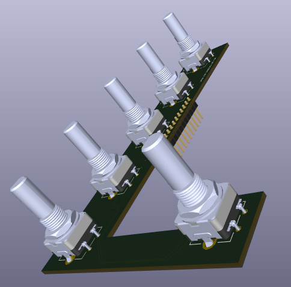

# ARC-164 Radio Panel for DCS

**Last updated: November 2, 2026 at 2:26 AM MST (America/Denver)**
<!-- Refresh this timestamp whenever this README changes; use the actual current America/Denver date and time with the correct MST/MDT abbreviation. -->

  

*Panel reference photo: PC Flights.*

## Project update — October 31, 2026

**The ARC-164 is now an active project**, and I’m working on its hardware and firmware.

## Current development order

For these two radio panels, I plan to build and test the **ARC-164**, followed by the **ARC-186**, then investigate additional aircraft support with matching physical radio panels.

**This order may change based on user feedback and interest.** These are plans, not fixed release dates.

## Other SIMPIT panels

Once I’ve finished the radio panels, I plan to build other panels for my SIMPIT, including the **SAS and emergency trim panels**. I’ll share those projects as they develop. These are future plans.

## Through-hole components

While I could use surface-mount (SMD) parts to make the boards smaller, I plan to use through-hole components to make the project easier for everyone to build and solder with basic tools.

I chose the listed component suppliers because I’m aiming for better-quality parts than I generally expect from generic Amazon listings, even if they cost a little more. Parts from Amazon may work, and I use some myself, but substitutes may have different dimensions or pin spacing and may not fit the PCBs I designed for this project. Please compare the exact part specifications and PCB footprint before buying a substitute.

## Things that need to be completed

**Last updated: November 1, 2026 at 10:22 PM MST (America/Denver)**
<!-- Refresh this section timestamp whenever the work list changes, using the actual America/Denver time and MST/MDT. -->

This is my current work list for the hardware, firmware, testing, and build instructions.

1. **Panel layout and parts:** Confirm dimensions, mounting clearances, controls, and the complete parts list. Measure and test-fit the proposed [three-block LED display arrangement](#seven-segment-display-plan), including digit visibility and brightness behind the smoked cover.
2. **PCB and schematic design:** Check clearances and test-fit the [published encoder PCB v1.1](#encoder-pcb-plan) before ordering boards. Design the Main PCB with the two A12515RNCQ switches and their resistor ladders mounted directly on it, along with the controller and display circuitry. Finalize Teensy pin assignments and check the complete electrical design.
3. **Printed parts:** Design and test-fit the required knobs, brackets, and spacers with the selected hardware.
4. **DCS-BIOS mappings and any needed changes:** Check which inputs and display outputs are already available for this radio. Identify missing data, make any necessary export changes, and document them. Check the correct ARC-164 radio instance for each intended A-10 variant.
5. **Firmware:** Write the control and display firmware and verify USB communication with DCS-BIOS.
6. **Bench and board testing:** Test the controls, displays, and power requirements together, then assemble and electrically test the manufactured boards.
7. **Dual ARC-164 support:** Integrate support for aircraft with two ARC-164 radios, such as the A-10C. I plan to use a single jumper on the Main PCB to select whether each panel operates as **Radio 1 or Radio 2**. Design the jumper input and firmware selection, verify the DCS-BIOS mappings for both radio instances, and test both panels together.
8. **Testing in DCS:** Check control operation, display updates, startup behavior, reconnection, and extended reliability with the intended aircraft and the other radio panels connected.
9. **Documentation:** Publish assembly instructions, wiring diagrams, final parts and print quantities, PCB ordering files, firmware loading steps, DCS-BIOS setup requirements, and troubleshooting notes.
10. **Assembly pictures:** During assembly, take clear pictures of component placement, soldering, wiring, and mounting, including both sides of each PCB with the silkscreen markings visible. Add the pictures to the assembly instructions so other builders can follow along.

## Controller choice — Teensy 4.1

I’m staying with the **Teensy 4.1** for the ARC-164. Its compact size makes it easier to fit behind the faceplate, it offers 42 readily accessible I/O pins. The final ARC-164 pin allocation still needs to be verified.

The **Teensy 4.1 runs at 600 MHz**, compared with **16 MHz for the classic Arduino Uno R3, Mega 2560, and ATmega328P Nano** — **37.5 times the CPU clock frequency**. This provides processing headroom for display updates and controls; it is not a measured 37.5-times improvement in display refresh speed. See the [Teensy specifications](https://www.pjrc.com/store/teensy41.html).

I considered the Arduino Due, but it is physically larger and would not save money at the prices checked on **October 30, 2026**: a genuine Due with headers was listed at **$49.40** at [DigiKey](https://www.digikey.com/en/products/detail/arduino/A000062/3712582), compared with **$31.50** for a Teensy 4.1 or **$35.95** with headers at [SparkFun](https://www.sparkfun.com/development-boards/microcontrollers/teensy/teensy-boards.html), before shipping and tax. These are reference prices, not fixed build costs.

Ethernet is not required for the planned USB DCS-BIOS connection. The Teensy 4.1 version without Ethernet is also an option; its listed price was **$29.60** at the same price check. Teensy 4.1 uses **3.3 V logic**, and its inputs are not 5 V tolerant, so display-driver connections must be designed accordingly. See the [PJRC specifications](https://www.pjrc.com/store/teensy41.html).

## Current PCBs

[View the current PCB versions and design files](PCBs/README.md).

## Encoder PCB plan

*ARC-164 Encoder PCB — KiCad 3D view. Click to enlarge. Clearance checks and test fitting are still pending.*

I’m using a **rotary encoder to select preset channels 1–20** because rotary switches suitable for this job are extremely expensive. The continuous-rotation eight-position switch I checked costs over US$50, so I chose the encoder to keep the project cost down. The firmware will map encoder movement to the channel selection. **The current encoder PCB will stay as designed**, with all six encoders on one board.

My initial check of the supplied faceplate DXF suggests that a single **L-shaped PCB** is feasible: one section across the five frequency encoders, with an extension up the right side to the channel encoder. Assuming the drawing is in millimeters:

- The faceplate measures **146 × 123.8 mm**.
- The five frequency encoders are spaced **26 mm center to center**.
- The channel encoder is approximately **53.6 mm above** the frequency row and almost aligned with the rightmost frequency encoder.

**I still need to check the clearances** for the encoder bodies and solder pins, the nearby switch beside the vertical section, display hardware, connectors, and PCB mounting points. The vertical section may need a notch or a narrower connecting strip. The DXF does not declare its units, so I also need to confirm its scale against the actual faceplate before finalizing the design or ordering boards.

I’ve published the [encoder PCB and schematic v1.1](PCBs/Rotary%20Encoders/). All six encoders are placed on one board, and the latest saved layout is routed with a GND pour. **Version 1.1 fixes the isolated-copper issue:** I removed an extra unassigned copper zone that was overriding the GND pour, then refilled it. Fresh electrical checks reported zero violations, zero unconnected items, and zero schematic/PCB parity issues under the saved project settings. **I still need to check clearances and test-fit the board behind the faceplate; this is not a manufacturing release.** The faceplate drawing and its reference geometry are not included.

## Seven-segment display plan

I plan to use **three four-digit seven-segment LED blocks** behind the smoked display cover: **two blocks for frequency** and **one for the preset channel**. The [Yuuhseel MAX7219 modules on Amazon](https://www.amazon.com/dp/B0FX9Q4PG6) are my current candidate for test fitting. I would remove the display blocks from their module PCBs and mount them to suit the faceplate; the driver circuitry can be positioned separately.

- **Frequency:** Use the middle six digits across two adjacent blocks, leaving the outermost digit at each end blank and hidden behind the faceplate.
- **Preset channel:** Use the middle two digits of one block for channels 1–20, leaving the outer two blank and hidden behind the faceplate.

My preliminary fit check assumes the common **30 × 14 mm four-digit package**. Two bodies would span about 60 mm behind the **53.5 × 17.5 mm frequency window**, and one would span 30 mm behind the **22 × 17.5 mm channel window**. The bodies can extend beyond the openings while the active digits remain visible. These are planning dimensions, not verified measurements of the Amazon parts.

**I still need to confirm the actual package dimensions, digit spacing, pinout, and mounting depth, then check clearance from the switches, encoder PCB, connectors, panel edge, and mounting hardware.** I also need to test brightness through the smoked cover and confirm the driver wiring and suitable 3.3 V-to-5 V logic buffering for the Teensy. This is a proposed layout, not a completed or test-fitted display design.

## TONE and SQL toggle switches

I plan to use a **spring-loaded momentary toggle for TONE**: hold it to activate the tone, then release it to return to OFF. For **SQL (SQUELCH)**, I plan to use a **normal maintained ON/OFF toggle** that stays in the selected position, with no spring return.

## MAIN and PRESET rotary switches

I plan to use **two C&K A12515RNCQ rotary switches**, one for MAIN and one for PRESET. These have the longer **38.1 mm (1.5-inch) flatted shaft**, **PCB through-hole terminals**, and **45° indexing**. See the [C&K A Series datasheet](https://www.ckswitches.com/media/1349/arotary.pdf).

I plan to mount **both switches directly on the Main PCB, with their resistor ladders on the same board**. I’ll secure MAIN and PRESET mechanically using their **threaded bushings, mounting nuts, and anti-rotation alignment holes**. The **PCB pins will provide the electrical connections**, rather than serving as the primary mechanical support. I’ll check the mounting stack and board spacing so tightening the nuts does not strain the pins or bend the Main PCB. This will avoid separate rotary-switch PCBs and the wiring between those boards and the Main PCB. I’ll use the ARC-210 switch circuit and footprint as a starting point, then check the pin assignments, component placement, and analog readings for this layout.

| Control | Stop-ring setting | Total travel |
| --- | --- | --- |
| MAIN: OFF–MAIN–BOTH–ADF | Limit the switch to **4 positions** | **135°** |
| PRESET: MNL–PRESET–GRD | Limit the switch to **3 positions** | **90°** |

I’ll set each stop ring before mounting the switch and check that it stops at the first and last labeled positions. The channel control will remain a rotary encoder on the encoder PCB.

**This mounting arrangement still needs design and test fitting.** I need to confirm the PCB footprint and orientation, mounting-hole and locating-tab fit, board spacing, shaft projection through the faceplate, knob fit, and clearance from the display blocks and encoder PCB. The longer shafts may need trimming after I check the complete assembly. I haven’t confirmed a purchase price for the A12515RNCQ yet.

## Separate controllers for each radio

The **ARC-164 and ARC-186 will each use their own Teensy 4.1 and USB connection to DCS-BIOS**, so either panel can be built and operated independently. This keeps the wiring and firmware separate and leaves room for future additions. Hardware, pin assignments, and firmware remain under development.

## USB connections and powered hubs

[Read about the USB connection plan and purchased powered hubs](https://github.com/dgdimick/ARC-210-DCS-Display/blob/master/Docs/USB-Connections-and-Powered-Hubs.md) for why I am using USB instead of RS-485.

## DCS-BIOS

I use [DCS-Skunkworks DCS-BIOS](https://github.com/DCS-Skunkworks/dcs-bios) to exchange control and display information with DCS, and [TekConnect](https://github.com/tekcreations/TekConnect) to manage my USB connections.

ARC-164 firmware, radio mappings, setup instructions, and any required export changes still need to be developed and tested. I’ll document the steps here as they become available.

## Physical radio panels and possible future support

I’m focusing future support on aircraft with a **physical radio control panel** that matches my hardware, so the panel will be useful to builders flying those aircraft. I’ll compare the controls and displays as well as the radio model. The A-10C/A-10C II remain my intended targets; the candidates below still need their own mappings and testing before I can support them.

| Aircraft | Physical panel | Future-support assessment |
| --- | --- | --- |
| F-16C Viper | ARC-164 UHF backup control panel | **Strongest next candidate.** The PC Flights faceplate used here reproduces this panel. Operation requires the aircraft's C&I selector in BACKUP. |
| F-5E Tiger II | Dedicated ARC-164 control panel | **Worth investigating.** Compare control positions, functions, and display behavior before committing to support. |
| C-101EB | Dedicated ARC-164 control panel | **Worth investigating.** Its layout and available functions differ, so hardware and firmware compatibility must be checked. |
| F-4E Phantom II | Dedicated UHF radio controls | **Lower priority; panel comparison required.** Its control arrangement differs substantially, so the presence of the radio alone does not establish a useful match for this build. |

References: [F-16C manual](https://www.digitalcombatsimulator.com/upload/iblock/3dc/5p9ejw7gi488n9zd15csrxxs8os2dflk/DCS_F-16C_Early_Access_Guide_EN.pdf), [F-5E manual](https://www.digitalcombatsimulator.com/upload/iblock/528/DCS%20F-5%D0%95-3%20Flight%20Manual_ENG.pdf), [C-101 cockpit guide](https://assets.chucksguides.com/pdf/DCS%20C-101CC%20Guide.pdf), and [F-4E cockpit guide](https://assets.chucksguides.com/aircraft/dcs/f-4e/0221930c6152572a4cc36908ded30c59/46.page.html).

**Each additional aircraft would need separate DCS-BIOS mappings, firmware integration, and testing.** Control inputs, display outputs, operating modes, and DCS-BIOS coverage must be checked for that module. These are investigation priorities, not compatibility claims or release commitments.

## Related radio projects

- [A-10-Sim repository](https://github.com/dgdimick/A-10-Sim) — my collection of A-10C II cockpit panel projects.
- [ARC-210 radio panel](https://github.com/dgdimick/ARC-210-DCS-Display) — my other radio panel project.
- [ARC-186 COMM-VHF radio panel](https://github.com/dgdimick/ARC-186-DCS-Display) — my planned VHF panel with its own Teensy 4.1 and USB connection.

## A central directory for SIMPIT builders

I’d love to see a central GitHub directory linking to other SIMPIT builders’ projects, with files and credit staying with each builder. This is an idea, not a project I’ve committed to building.

[Read more about the directory idea](https://github.com/dgdimick/ARC-210-DCS-Display/blob/master/Docs/Future-Thoughts.md#a-central-directory-for-simpit-builders). If you know of one or would like to discuss it, let me know in [Discussions](https://github.com/dgdimick/ARC-164-DCS-Display/discussions).

## Sharing code and improvements

I plan to share this panel’s main firmware source under the [MIT License](https://github.com/dgdimick/ARC-164-DCS-Display/blob/main/Docs/LICENSE-MIT.txt). The firmware is still being developed, and I’m happy to share available work with anyone who asks.

If you adapt my code or add improvements, I’d love to work with you and bring useful changes back into the project so other builders—and my other panel projects—can benefit too. Please share your changes through a pull request or get in touch in [Discussions](https://github.com/dgdimick/ARC-164-DCS-Display/discussions). Contributing changes back is welcome, but it isn’t an extra condition of the MIT License. Third-party code keeps its own license.

## Questions and community builds

**Planning a build, already working on one, or just looking around?** Tell me which panel interests you and what you fly in [GitHub Discussions](https://github.com/dgdimick/ARC-164-DCS-Display/discussions). Questions, ideas, and progress photos are welcome—even if you haven’t started yet. If you get stuck, ask away—I’m happy to help where I can.

If you’re local to me in **New Mexico, USA**, I’d be happy to meet up and provide whatever help I can with your SIMPIT. Get in touch through [Discussions](https://github.com/dgdimick/ARC-164-DCS-Display/discussions) so we can talk about your build and arrange a time.

I welcome bug reports from anyone using the project—**even tiny bugs are worth reporting**. If something doesn’t work as expected, please let me know in the [Bugs discussion section](https://github.com/dgdimick/ARC-164-DCS-Display/discussions/categories/bugs). Tell me which firmware version and board revision you’re using, if applicable, what you did, what you expected, and what happened. Reports about the build instructions are welcome too. Your reports help me improve the project for everyone.

## PC Flights affiliation

I am not affiliated with [PC Flights](https://pcflights.com/) in any way. I simply chose to use their panels for my own cockpit projects. PC Flights has supplied me with a drawing file to assist with the Button PCB layout.

## Disclaimer

This is a hobby flight-simulation project, not equipment intended for use in real aircraft. Software, firmware, PCB designs, wiring information, and printable parts are provided "as is," without warranty, subject to their respective licenses.

Users are responsible for verifying compatibility, wiring, supply voltages, assembly, and safe operation before use. To the maximum extent permitted by applicable law, the authors and contributors disclaim liability for injury, equipment damage, data loss, or other losses arising from use of this project.

## Licensing

- **PCBs:** [CERN Open Hardware Licence Version 2 – Permissive (CERN-OHL-P-2.0)](https://github.com/dgdimick/ARC-164-DCS-Display/blob/main/Docs/LICENSE-CERN-OHL-P-2.0.txt)
- **Teensy firmware:** [MIT License](https://github.com/dgdimick/ARC-164-DCS-Display/blob/main/Docs/LICENSE-MIT.txt)
- **STL files:** [Creative Commons Attribution 4.0 International (CC BY 4.0)](https://github.com/dgdimick/ARC-164-DCS-Display/blob/main/Docs/LICENSE-CC-BY-4.0.txt)

Copies of the applicable licenses are included in the [Docs directory](https://github.com/dgdimick/ARC-164-DCS-Display/tree/main/Docs). Firmware and printable parts are still under development; these license terms do not mean those files have been released. Third-party code, libraries, and models retain their own licenses.
