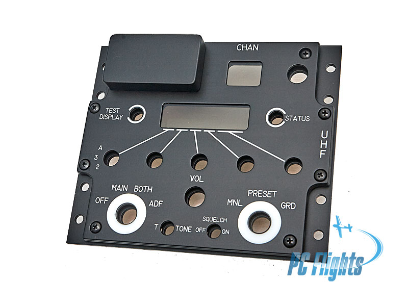

# ARC-164 Radio Panel for DCS

**Last updated: October 30, 2026 at 9:01 PM MDT (America/Denver)**
<!-- Refresh this timestamp whenever this README changes; use the actual current America/Denver date and time with the correct MST/MDT abbreviation. -->

  

*Panel reference photo: PC Flights.*

## Panel compatibility

I’ve purchased and checked the [PC Flights F-16C Viper UHF panel](https://pcflights.com/f-16c-viper-uhf-radio-control-home-cockpit-panel/) and confirmed it suits this A-10C II ARC-164 build. F-16C DCS-BIOS firmware support is a separate task.

## October 10, 2026 — Project update

I have almost completed the [ARC-210 project](https://github.com/dgdimick/ARC-210-DCS-Display), and I have ordered the **ARC-164 and ARC-184 faceplates**. Once the ARC-210 is finished and the new faceplates arrive, I can take a closer look at the next builds.

## My next project

Once I have completed the [ARC-210 radio panel](https://github.com/dgdimick/ARC-210-DCS-Display), the **AN/ARC-164 UHF radio panel** will be my next project.

The plan is to build a physical ARC-164 panel for my DCS A-10C II cockpit, with working controls and a display linked to DCS through DCS-BIOS.

This repository is a placeholder for now. I am exploring display options and the panel layout, but the ARC-210 remains my priority. There is no firmware or finished hardware design available here yet, and I have not set a release date.

As development progresses, I will add build notes, hardware details, firmware, and photos here.

## Controller choice — Teensy 4.1

I’m staying with the **Teensy 4.1** for the ARC-164. Its compact size makes it easier to fit behind the faceplate, it offers 42 readily accessible I/O pins, and it keeps the controller consistent with the ARC-210 project. The final ARC-164 pin allocation still needs to be verified.

The **Teensy 4.1 runs at 600 MHz**, compared with **16 MHz for the classic Arduino Uno R3, Mega 2560, and ATmega328P Nano** — **37.5 times the CPU clock frequency**. This provides processing headroom for display updates and controls; it is not a measured 37.5-times improvement in display refresh speed. See the [Teensy specifications](https://www.pjrc.com/store/teensy41.html) and [classic Arduino board comparison](https://github.com/dgdimick/ARC-210-DCS-Display/blob/master/Docs/Why-Teensy.md).

I considered the Arduino Due, but it is physically larger and would not save money at the prices checked on **October 30, 2026**: a genuine Due with headers was listed at **$49.40** at [DigiKey](https://www.digikey.com/en/products/detail/arduino/A000062/3712582), compared with **$31.50** for a Teensy 4.1 or **$35.95** with headers at [SparkFun](https://www.sparkfun.com/development-boards/microcontrollers/teensy/teensy-boards.html), before shipping and tax. These are reference prices, not fixed build costs.

Ethernet is not required for the planned USB DCS-BIOS connection. The Teensy 4.1 version without Ethernet is also an option; its listed price was **$29.60** at the same price check. Teensy 4.1 uses **3.3 V logic**, and its inputs are not 5 V tolerant, so display-driver connections must be designed accordingly. See the [PJRC specifications](https://www.pjrc.com/store/teensy41.html).

## Why I keep using Teensy 4.1s

[Read why I keep using Teensy 4.1s](https://github.com/dgdimick/ARC-210-DCS-Display/blob/master/Docs/Why-I-Keep-Using-Teensy-4.1s.md) for the consistency, processing speed, available pins, and cost comparison behind the controller choice.

## Encoder PCB plan

The ARC-164 will need a **new encoder PCB**, because its frequency-encoder positions do not line up with the ARC-210 encoder PCB. The plan is to mount **all five frequency encoders and the preset-channel encoder on one PCB**, assuming there is enough room and clearance behind the faceplate. The final board outline and encoder placement will be confirmed during the mechanical layout.

## Separate controllers for each radio

The **ARC-164 and ARC-186 will each use their own Teensy 4.1**, with a separate USB connection to DCS-BIOS for each panel. Either radio can be built and operated independently. Dedicated controllers keep each panel's wiring and firmware separate and leave room for future additions.

The ARC-164 controller will operate the ARC-164 only; the [ARC-186 COMM-VHF panel](https://github.com/dgdimick/ARC-186-DCS-Display) will have its own controller. Hardware, pin assignments, and firmware remain under development.

## My SIMPIT and test computer

[View my SIMPIT and test computer](https://github.com/dgdimick/ARC-210-DCS-Display/blob/master/Docs/My-SIMPIT-and-Test-Computer.md) for my computer configuration, monitors, and current USB setup. **This describes my own development and flight-simulation setup, not minimum requirements for the radio panels.**

## USB connections and powered hubs

[Read about the USB connection plan and purchased powered hubs](https://github.com/dgdimick/ARC-210-DCS-Display/blob/master/Docs/USB-Connections-and-Powered-Hubs.md) for why I am using USB instead of RS-485, GPIO availability, sharing a Teensy across smaller panels, and expansion using my existing cockpit USB setup.

## DCS-BIOS

[Read my step-by-step DCS-BIOS setup guide](https://github.com/dgdimick/ARC-210-DCS-Display/blob/master/Docs/DCS-BIOS.md) for installation, the required `Export.lua` and ARC-210 `A-10C.lua` file changes, firmware loading, and TekConnect—the app I use to manage my USB serial connections. It also covers testing and troubleshooting. 

The guide includes a [downloadable A-10C.lua with my ARC-210 changes already added](https://raw.githubusercontent.com/dgdimick/ARC-210-DCS-Display/master/Docs/DCS-BIOS/A-10C.lua) for **DCS-BIOS v0.11.8**, so users of that version can follow the replacement instructions instead of editing the code themselves. The ARC-210-specific edits do not add support for this planned radio.

## Physical radio panels and possible future support

Future support will focus on aircraft with a **physical radio control panel** that this hardware can reasonably represent. Having an ARC-164 transceiver controlled only through integrated avionics is not enough. The A-10C/A-10C II remain the intended targets; the candidates below are **not currently supported**.

| Aircraft | Physical panel | Future-support assessment |
| --- | --- | --- |
| F-16C Viper | ARC-164 UHF backup control panel | **Strongest next candidate.** The PC Flights faceplate used here reproduces this panel. Operation requires the aircraft's C&I selector in BACKUP. |
| F-5E Tiger II | Dedicated ARC-164 control panel | **Worth investigating.** Compare control positions, functions, and display behavior before committing to support. |
| C-101EB | Dedicated ARC-164 control panel | **Worth investigating.** Its layout and available functions differ, so hardware and firmware compatibility must be checked. |
| F-4E Phantom II | Dedicated UHF radio controls | **Lower priority; panel comparison required.** Its control arrangement differs substantially, so the presence of the radio alone does not establish a useful match for this build. |

References: [F-16C manual](https://www.digitalcombatsimulator.com/upload/iblock/3dc/5p9ejw7gi488n9zd15csrxxs8os2dflk/DCS_F-16C_Early_Access_Guide_EN.pdf), [F-5E manual](https://www.digitalcombatsimulator.com/upload/iblock/528/DCS%20F-5%D0%95-3%20Flight%20Manual_ENG.pdf), [C-101 cockpit guide](https://assets.chucksguides.com/pdf/DCS%20C-101CC%20Guide.pdf), and [F-4E cockpit guide](https://assets.chucksguides.com/aircraft/dcs/f-4e/0221930c6152572a4cc36908ded30c59/46.page.html).

**Each additional aircraft would need separate DCS-BIOS mappings, firmware integration, and testing.** Control inputs, display outputs, operating modes, and DCS-BIOS coverage must be checked for that module. These are investigation priorities, not compatibility claims or release commitments.

## Related radio project

Follow the [ARC-186 COMM-VHF radio panel project](https://github.com/dgdimick/ARC-186-DCS-Display) for its build plans using a dedicated Teensy 4.1 and its own USB connection.

## Questions and community builds

Visit [GitHub Discussions](https://github.com/dgdimick/ARC-164-DCS-Display/discussions) to ask questions, share ideas, and post photos of your build. Whether you’re planning your panel or already working on it, you’re welcome to join in!

## PC Flights affiliation

I am not affiliated with [PC Flights](https://pcflights.com/) in any way. I simply chose to use their panels for my own cockpit projects.
