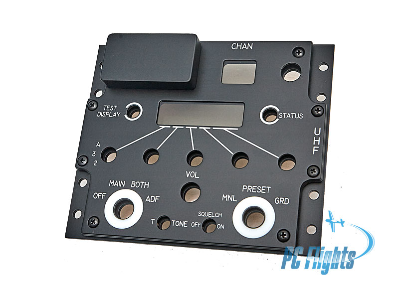
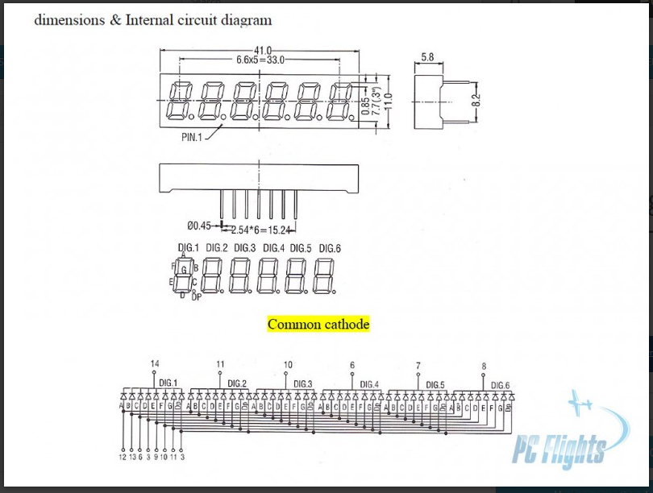
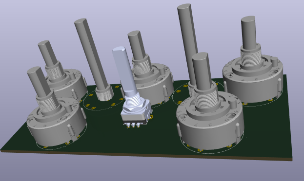

# ARC-164 Radio Panel for DCS

**Last updated: November 3, 2026 at 1:10 AM MST (America/Denver)**
<!-- Refresh this timestamp whenever this README changes; use the actual current America/Denver date and time with the correct MST/MDT abbreviation. -->

  

*Panel reference photo: PC Flights.*

I’m developing the hardware and firmware for my ARC-164 radio panel.

## Current development order

For these two radio panels, I plan to build and test the **ARC-164**, followed by the **ARC-186**, then investigate additional aircraft support with matching physical radio panels.

**This order may change based on user feedback and interest.** These are plans, not fixed release dates.

## Other SIMPIT panels

Once I’ve finished the radio panels, I plan to build other panels for my SIMPIT, including the **SAS and emergency trim panels**. I’ll share those projects as they develop. These are future plans.

## Through-hole components

While I could use surface-mount (SMD) parts to make the boards smaller, I plan to use through-hole components to make the project easier for everyone to build and solder with basic tools.

I chose the listed component suppliers because I’m aiming for better-quality parts than I generally expect from generic Amazon listings, even if they cost a little more. Parts from Amazon may work, and I use some myself, but substitutes may have different dimensions or pin spacing and may not fit the PCBs I designed for this project. Please compare the exact part specifications and PCB footprint before buying a substitute.

## Things that need to be completed

**Last updated: November 3, 2026 at 1:10 AM MST (America/Denver)**
<!-- Refresh this section timestamp whenever the work list changes, using the actual America/Denver time and MST/MDT. -->

This is my current work list for the hardware, firmware, testing, and build instructions.

1. **Panel layout and parts:** Confirm dimensions, mounting clearances, controls, and the complete parts list. Test the displays due to arrive on **November 3, 2026**, checking their dimensions, fit behind both windows, digit visibility, and brightness through the smoked cover. Compare the results with the [PC Flights six-digit alternative](#another-frequency-display-option), then choose the final frequency and preset-channel display setup. **Frequency-knob travel in DCS:** I’ll check whether each 0–9 selector wraps from 9 to 0 or stops, whether the final-digit selector wraps from 75 to 00 or stops, and the order and end stops of 2/3/A. I’ll use those results to verify the frequency-switch operation before finalizing the PCB design. This checks DCS behavior; it does not establish the real radio’s mechanical travel.
2. **PCB and schematic design:** Design the Main PCB with the selected rotary switches, resistor ladders, controller, and display circuitry. Finalize Teensy pin assignments, check the complete electrical design, and verify clearances and test fitting before ordering boards.
3. **Printed parts:** Design and test-fit the required knobs, brackets, and spacers with the selected hardware, including the longer FREQ 2 and 4 knob stems with set screws near the bottom. Verify shaft engagement, screw retention, and clearance through the upper PCB. Design and test the shaft guides for the staggered frequency-switch arrangement, with separate hole sizes for the 6 mm and 6.35 mm shafts and enough clearance for free rotation. Design and test a tube-style shaft cutting guide; set its length after checking the PCB spacing and knob position.
4. **DCS-BIOS mappings and any needed changes:** Check which inputs and display outputs are already available for this radio. Identify missing data, make any necessary export changes, and document them. Check the correct ARC-164 radio instance for each intended A-10 variant.
5. **Firmware:** Write the control and display firmware and verify USB communication with DCS-BIOS.
6. **Bench and board testing:** Test the controls, displays, and power requirements together, then assemble and electrically test the manufactured boards.
7. **Dual ARC-164 support:** Integrate support for aircraft with two ARC-164 radios, such as the A-10C. I plan to use a single jumper on the Main PCB to select whether each panel operates as **Radio 1 or Radio 2**. Design the jumper input and firmware selection, verify the DCS-BIOS mappings for both radio instances, and test both panels together.
8. **Testing in DCS:** Check control operation, display updates, startup behavior, reconnection, and extended reliability with the intended aircraft and the other radio panels connected.
9. **Documentation:** Publish assembly instructions, wiring diagrams, final parts and print quantities, PCB ordering files, firmware loading steps, DCS-BIOS setup requirements, and troubleshooting notes.
10. **Assembly pictures:** During assembly, take clear pictures of component placement, soldering, wiring, and mounting, including both sides of each PCB with the silkscreen markings visible. Add the pictures to the assembly instructions so other builders can follow along.

## Controller choice — Teensy 4.1

I’m using the **Teensy 4.1** for its compact size and room for the panel’s controls and displays. It runs at **600 MHz**, compared with **16 MHz for the classic Arduino Uno R3, Mega 2560, and ATmega328P Nano**. I still need to finalize the pin assignments. See the [Teensy specifications](https://www.pjrc.com/store/teensy41.html).

I’ll use USB for DCS-BIOS; Ethernet isn’t needed. The Teensy uses **3.3 V logic**, and its inputs are **not 5 V tolerant**, so I’ll design the display-driver connections accordingly.

## Seven-segment display plan

I plan to use **three four-digit seven-segment LED blocks** behind the smoked display cover: **two blocks for frequency** and **one for the preset channel**. The [Yuuhseel MAX7219 modules on Amazon](https://www.amazon.com/dp/B0FX9Q4PG6) are my current candidate for test fitting. I would remove the display blocks from their module PCBs and mount them to suit the faceplate; the driver circuitry can be positioned separately.

- **Frequency:** Use the middle six digits across two adjacent blocks, leaving the outermost digit at each end blank and hidden behind the faceplate.
- **Preset channel:** Use the middle two digits of one block for channels 1–20, leaving the outer two blank and hidden behind the faceplate.

My preliminary fit check assumes the common **30 × 14 mm four-digit package**. Two bodies would span about 60 mm behind the **53.5 × 17.5 mm frequency window**, and one would span 30 mm behind the **22 × 17.5 mm channel window**. The bodies can extend beyond the openings while the active digits remain visible. These are planning dimensions, not verified measurements of the Amazon parts.

**I still need to confirm the actual package dimensions, digit spacing, pinout, and mounting depth, then check clearance from the switches, PCB, connectors, panel edge, and mounting hardware.** I also need to test brightness through the smoked cover and confirm the driver wiring and suitable 3.3 V-to-5 V logic buffering for the Teensy. This is a proposed layout, not a completed or test-fitted display design.

### Another frequency-display option

The [PC Flights six-digit 0.3-inch amber seven-segment display](https://pcflights.com/6-digits-7-segment-led-display-03-amber/) is another option for the frequency display. Its drawing shows a **41 × 11 mm body, 5.8 mm thick**, with approximately **7.7 mm-tall digits**. It is **common cathode**, with a decimal point on every digit, so it can show a frequency such as **251.000**. The body fits within the **53.5 × 17.5 mm frequency window**, but I still need to check the mounting, driver wiring, brightness through the smoked cover, and clearance behind the faceplate.

*PC Flights display drawing. Click to enlarge the dimensions and pinout.*

**The displays I’ve already bought are due to arrive tomorrow, November 3, 2026. I’ll measure and test-fit those first, including how they look through the smoked cover, before deciding which displays to use.** I haven’t selected the PC Flights display as the final choice.

## Current shaft-length plan

My current ARC-164 hardware plan is:

| Control | Planned shaft length |
| --- | --- |
| FREQ 1 and 5 rotary switches | **38.1 mm** |
| FREQ 2, 3, and 4 — A11015RNCQ ten-position rotary switches | **38.1 mm**; extended knobs for FREQ 2 and 4 |
| MAIN and PRESET rotary switches | **38.1 mm** |
| VOL encoder — PEC11R-4230F-S0024 | **30 mm** |

## Frequency switches and extended knobs

I’ll use the **C&K A11015RNCQ** for **FREQ 2, 3, and 4**. It has **ten positions, 30° indexing, PCB-pin terminals, and a 38.1 mm-long, 6.35 mm-diameter D-shaped shaft**. See the [DigiKey listing](https://www.digikey.com/en/products/detail/c-k/A11015RNCQ/3751827) and [C&K datasheet](https://www.ckswitches.com/media/1349/arotary.pdf).

For **FREQ 2 and 4**, I’ll design **longer 3D-printed knob stems with the shaft extension built in**. Each will have a **set screw near the bottom of the stem**, where it grips the switch shaft, to keep the knob secured. The D-shaped socket will transmit the turning force. I’ll set the extension length after checking the PCB spacing and final knob position, then print and test the fit and screw retention. This replaces the earlier plan to buy longer shafts for FREQ 2 and 4.

## Staggered frequency-switch mounting plan

*Click the picture to enlarge. This is my current KiCad 3D fit-check layout.*

**The upper PCB will need clearance holes for the shafts and extended knob stems passing through from the lower PCB.** I’ll size and position these openings so they can turn freely without touching the board.

I plan to try **two PCB levels with staggered switch mounting**, using the lengths in the table above. I’ll set the mounting depths and PCB spacing first, then trim the shafts as needed so the knobs line up at the front of the panel. The mounting nuts will secure the switches as needed. This is a proposed arrangement, not a completed design.

Before ordering boards, I’ll test-fit the complete mounting stack, including MAIN and PRESET and the printed shaft guides. I’ll check switch-body and display clearance, PCB edges, resistor leads, solder joints, connectors, wiring, footprint orientation, mounting holes, locating tabs, shaft projection, and knob fit. I’ll also check that the shafts turn freely and that the mounting hardware supports the switches without straining their soldered pins or bending the boards. See the [C&K shaft options](https://www.ckswitches.com/media/1349/arotary.pdf).

I still need to verify the final switch models, contact counts, PCB footprints, and resistor ladders, and check frequency-selector travel in DCS.

## 3D-printed shaft guides

I plan to design **3D-printed shaft guides** to keep the frequency-switch shafts centered through the faceplate in the staggered mounting arrangement. I’ll use **guide holes for the 6.35 mm shafts on the planned 38.1 mm rotary switches, with separate 6 mm holes where the selected hardware requires them**, allowing enough clearance for the shafts to turn freely. The final printed hole dimensions will depend on test fitting, rather than matching the shaft diameters exactly.

The guides will support and locate the shafts; the switch bodies will have separate secure mounts to resist knob-turning force. I’ll check the printed guides for wear during testing.

## 3D-printed shaft cutting guide

I also plan to make a **3D-printed tube-style cutting guide** that slips over the **6.35 mm shafts** to provide a repeatable cutting reference for the frequency-switch shafts that need trimming. **I’ll set the guide’s length after checking the PCB spacing and knob position**, so the finished shafts place all the knobs at the same height.

## VOL rotary encoder selection

I’ve selected the **Bourns PEC11R-4230F-S0024** for the **VOL rotary encoder**, using its **30 mm long, 6 mm diameter flatted shaft**. It has **24 detents, 24 pulses per revolution, PCB terminals, and a momentary push switch**. See the [Mouser listing](https://www.mouser.com/en/ProductDetail/Bourns/PEC11R-4230F-S0024?qs=Zq5ylnUbLm6MC5h%2FLr6Brg%3D%3D).

## TONE and STATUS controls

I plan to use a **spring-loaded momentary toggle for TONE**: hold it to activate the tone, then release it to return to OFF.

For **STATUS**, I plan to use a **normally open momentary pushbutton, not a light**. The contacts close while the button is pressed and open again when it is released.

## Assembly tool note

I use **10 mm and 13 mm deep-well sockets** to tighten the **mounting nuts on the rotary switches and encoders**. Use whichever socket fits each nut; the deep well provides clearance over the shaft.

## MAIN and PRESET rotary switches

I plan to use **two C&K A12515RNCQ rotary switches**, one for MAIN and one for PRESET. These have the longer **38.1 mm (1.5-inch) flatted shaft**, **PCB through-hole terminals**, and **45° indexing**. See the [C&K A Series datasheet](https://www.ckswitches.com/media/1349/arotary.pdf).

I plan to mount **both switches directly on the Main PCB, with their resistor ladders on the same board**. I’ll secure MAIN and PRESET mechanically using their **threaded bushings, mounting nuts, and anti-rotation alignment holes**. The **PCB pins will provide the electrical connections**, rather than serving as the primary mechanical support. I’ll check the mounting stack and board spacing so tightening the nuts does not strain the pins or bend the Main PCB. This will avoid separate rotary-switch PCBs and the wiring between those boards and the Main PCB. I’ll use the ARC-210 switch circuit and footprint as a starting point, then check the pin assignments, component placement, and analog readings for this layout.

| Control | Stop-ring setting | Total travel |
| --- | --- | --- |
| MAIN: OFF–MAIN–BOTH–ADF | Limit the switch to **4 positions** | **135°** |
| PRESET: MNL–PRESET–GRD | Limit the switch to **3 positions** | **90°** |

I’ll set each stop ring before mounting the switch and check that it stops at the first and last labeled positions.

I haven’t confirmed a purchase price for the A12515RNCQ yet.

## Channel control

I’ll use a rotary encoder for the channel control. Its mounting still needs design and testing.

## USB connections and powered hubs

[Read about the USB connection plan and purchased powered hubs](https://github.com/dgdimick/ARC-210-DCS-Display/blob/master/Docs/USB-Connections-and-Powered-Hubs.md) for why I am using USB instead of RS-485.

## DCS-BIOS

I use [DCS-Skunkworks DCS-BIOS](https://github.com/DCS-Skunkworks/dcs-bios) to exchange control and display information with DCS, and [TekConnect](https://github.com/tekcreations/TekConnect) to manage my USB connections.

ARC-164 firmware, radio mappings, setup instructions, and any required export changes still need to be developed and tested. I’ll document the steps here as they become available.

## Physical radio panels and possible future support

I’m focusing future support on aircraft with a **physical radio control panel** that matches my hardware, so the panel will be useful to builders flying those aircraft. I’ll compare the controls and displays as well as the radio model. The A-10C/A-10C II remain my intended targets; the candidates below still need their own mappings and testing before I can support them.

| Aircraft | Physical panel | Future-support assessment |
| --- | --- | --- |
| F-16C Viper | ARC-164 UHF backup control panel | **Strongest next candidate.** The PC Flights faceplate used here reproduces this panel. Operation requires the aircraft's C&I selector in BACKUP. |
| F-5E Tiger II | Dedicated ARC-164 control panel | **Worth investigating.** Compare control positions, functions, and display behavior before committing to support. |
| C-101EB | Dedicated ARC-164 control panel | **Worth investigating.** Its layout and available functions differ, so hardware and firmware compatibility must be checked. |
| F-4E Phantom II | Dedicated UHF radio controls | **Lower priority; panel comparison required.** Its control arrangement differs substantially, so the presence of the radio alone does not establish a useful match for this build. |

References: [F-16C manual](https://www.digitalcombatsimulator.com/upload/iblock/3dc/5p9ejw7gi488n9zd15csrxxs8os2dflk/DCS_F-16C_Early_Access_Guide_EN.pdf), [F-5E manual](https://www.digitalcombatsimulator.com/upload/iblock/528/DCS%20F-5%D0%95-3%20Flight%20Manual_ENG.pdf), [C-101 cockpit guide](https://assets.chucksguides.com/pdf/DCS%20C-101CC%20Guide.pdf), and [F-4E cockpit guide](https://assets.chucksguides.com/aircraft/dcs/f-4e/0221930c6152572a4cc36908ded30c59/46.page.html).

**Each additional aircraft would need separate DCS-BIOS mappings, firmware integration, and testing.** Control inputs, display outputs, operating modes, and DCS-BIOS coverage must be checked for that module. These are investigation priorities, not compatibility claims or release commitments.

## Related radio projects

- [A-10-Sim repository](https://github.com/dgdimick/A-10-Sim) — my collection of A-10C II cockpit panel projects.
- [ARC-210 radio panel](https://github.com/dgdimick/ARC-210-DCS-Display) — my other radio panel project.
- [ARC-186 COMM-VHF radio panel](https://github.com/dgdimick/ARC-186-DCS-Display) — my planned VHF panel with its own Teensy 4.1 and USB connection.

## A central directory for SIMPIT builders

I’d love to see a central GitHub directory linking to other SIMPIT builders’ projects, with files and credit staying with each builder. This is an idea, not a project I’ve committed to building.

[Read more about the directory idea](https://github.com/dgdimick/ARC-210-DCS-Display/blob/master/Docs/Future-Thoughts.md#a-central-directory-for-simpit-builders). If you know of one or would like to discuss it, let me know in [Discussions](https://github.com/dgdimick/ARC-164-DCS-Display/discussions).

## Sharing code and improvements

I plan to share this panel’s main firmware source under the [MIT License](https://github.com/dgdimick/ARC-164-DCS-Display/blob/main/Docs/LICENSE-MIT.txt). The firmware is still being developed, and I’m happy to share available work with anyone who asks.

If you adapt my code or add improvements, I’d love to work with you and bring useful changes back into the project so other builders—and my other panel projects—can benefit too. Please share your changes through a pull request or get in touch in [Discussions](https://github.com/dgdimick/ARC-164-DCS-Display/discussions). Contributing changes back is welcome, but it isn’t an extra condition of the MIT License. Third-party code keeps its own license.

## Questions and community builds

**Planning a build, already working on one, or just looking around?** Tell me which panel interests you and what you fly in [GitHub Discussions](https://github.com/dgdimick/ARC-164-DCS-Display/discussions). Questions, ideas, and progress photos are welcome—even if you haven’t started yet. If you get stuck, ask away—I’m happy to help where I can.

If you’re local to me in **New Mexico, USA**, I’d be happy to meet up and provide whatever help I can with your SIMPIT. Get in touch through [Discussions](https://github.com/dgdimick/ARC-164-DCS-Display/discussions) so we can talk about your build and arrange a time.

I welcome bug reports from anyone using the project—**even tiny bugs are worth reporting**. If something doesn’t work as expected, please let me know in the [Bugs discussion section](https://github.com/dgdimick/ARC-164-DCS-Display/discussions/categories/bugs). Tell me which firmware version and board revision you’re using, if applicable, what you did, what you expected, and what happened. Reports about the build instructions are welcome too. Your reports help me improve the project for everyone.

## PC Flights affiliation

I am not affiliated with [PC Flights](https://pcflights.com/) in any way. I simply chose to use their panels for my own cockpit projects. PC Flights has supplied me with a drawing file to assist with the Button PCB layout.

## Disclaimer

This is a hobby flight-simulation project, not equipment intended for use in real aircraft. Software, firmware, PCB designs, wiring information, and printable parts are provided "as is," without warranty, subject to their respective licenses.

Users are responsible for verifying compatibility, wiring, supply voltages, assembly, and safe operation before use. To the maximum extent permitted by applicable law, the authors and contributors disclaim liability for injury, equipment damage, data loss, or other losses arising from use of this project.

## Licensing

- **PCBs:** [CERN Open Hardware Licence Version 2 – Permissive (CERN-OHL-P-2.0)](https://github.com/dgdimick/ARC-164-DCS-Display/blob/main/Docs/LICENSE-CERN-OHL-P-2.0.txt)
- **Teensy firmware:** [MIT License](https://github.com/dgdimick/ARC-164-DCS-Display/blob/main/Docs/LICENSE-MIT.txt)
- **STL files:** [Creative Commons Attribution 4.0 International (CC BY 4.0)](https://github.com/dgdimick/ARC-164-DCS-Display/blob/main/Docs/LICENSE-CC-BY-4.0.txt)

Copies of the applicable licenses are included in the [Docs directory](https://github.com/dgdimick/ARC-164-DCS-Display/tree/main/Docs). Firmware and printable parts are still under development; these license terms do not mean those files have been released. Third-party code, libraries, and models retain their own licenses.
